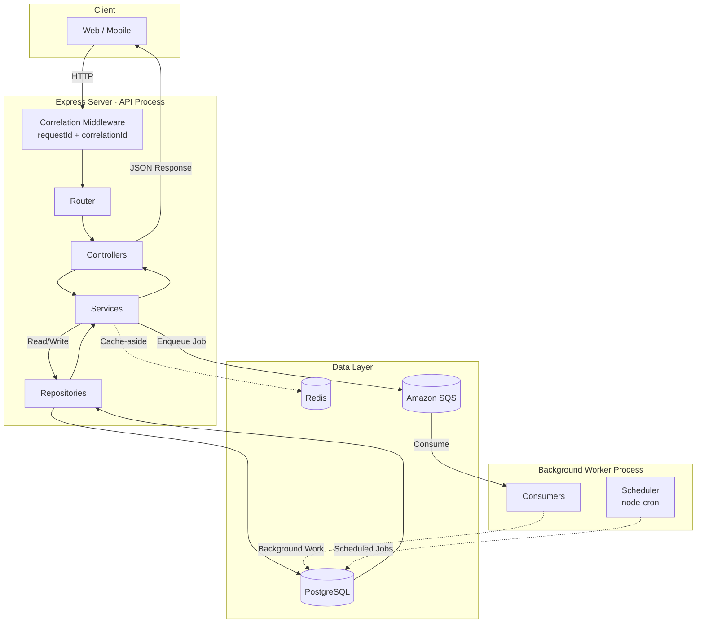
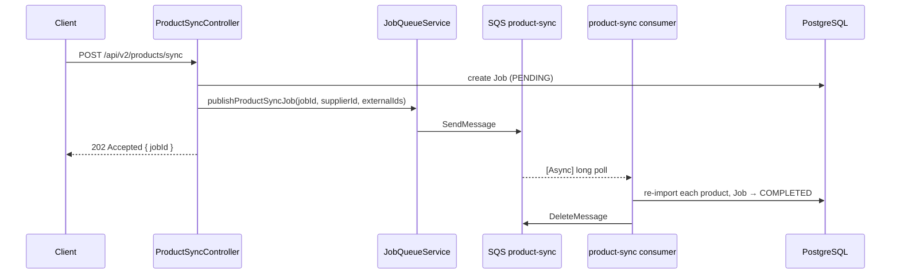

<div align="center">
  
  <h1>Node.js Enterprise Backend Template</h1>
  <p>A production-ready backend platform foundation with Event-Driven Architecture, full Observability, and automated testing.</p>

  <div>
    
    
    
    
  </div>
  <br />
  <div>
    
    
    
    
    
    
    
    
    
  </div>
</div>

<hr />

## ⚡ Infrastructure Stack

| Layer              | Technology                                            |
| ------------------ | ----------------------------------------------------- |
| **API Framework**  | Express.js + TypeScript                               |
| **Database**       | PostgreSQL via Prisma ORM                             |
| **Job Queue**      | Amazon SQS (DLQ redrive, retries) — LocalStack in dev |
| **Cache / State**  | Redis (TLS-ready, cache-aside pattern)                |
| **Authentication** | JWT (Access + Refresh tokens)                         |
| **Validation**     | Joi                                                   |
| **Email**          | Nodemailer + Handlebars templates (Ethereal for dev)  |
| **Scheduling**     | node-cron                                             |
| **Logging**        | Winston (JSON in prod / colorized in dev)             |
| **Security**       | Helmet, CORS, express-rate-limit                      |
| **API Docs**       | Swagger / OpenAPI (dev only)                          |
| **Testing**        | Jest + ts-jest + Supertest                            |
| **CI/CD**          | GitHub Actions                                        |
| **Containers**     | Docker + Docker Compose                               |

---

## 🗺️ Architecture Overview



---

## 🎯 Why this template?

Most Express boilerplates stop at **JWT + Prisma**. This template gives you the architecture of a serious production enterprise platform:

- **Domain-Driven Design (DDD)** — Source code logically grouped by domain under `src/modules/`
- **Modular Database Schema** — Prisma models split into multiple files under `prisma/schema/`
- **Multi-Tenant Ready** — Strict tenant isolation built directly into the database constraints
- **Background Jobs** — slow work goes to Amazon SQS queues with DLQs, handled by a separate worker
- **Full Observability** — Correlation IDs flow from HTTP → SQS → Worker → every log line
- **Production-Grade Resilience** — Exponential backoff reconnect, graceful shutdown, health probes
- **Developer-Ready Helpers** — Response formatting, pagination, caching, and error throwing utilities included
- **Test Coverage** — Unit + Integration tests wired up from day one

### 🚫 Non-Goals

This template intentionally does not include:

- Microservices
- GraphQL
- CQRS / Event Sourcing
- Socket.IO
- Kubernetes manifests
- AWS-specific integrations

These can be added as extensions, but are intentionally excluded from the core template to keep the foundation deterministic, maintainable, and broadly applicable.

---

## 📦 Getting Started

### Prerequisites

- [Node.js](https://nodejs.org/) v20+
- [Docker](https://www.docker.com/) & Docker Compose

### Installation

```bash
# 1. Clone the repo
git clone <your-repo-url>
cd node-postg-template

# 2. Install dependencies
npm install

# 3. Copy and configure environment
cp .env.example .env

# 4. Start infrastructure (PostgreSQL · Redis · LocalStack SQS) — waits until the queues exist
docker compose up -d --wait

# 5. Run database migrations
npm run db:setup

# 6. Start the API server
npm run dev
```

In a **separate terminal**, start the background worker:

```bash
npm run worker
```

| Service          | URL                              |
| ---------------- | -------------------------------- |
| API              | `http://localhost:3002`          |
| Swagger Docs     | `http://localhost:3002/api/docs` |
| LocalStack (SQS) | `http://localhost:4566`          |
| Worker Health    | `http://localhost:8080/health`   |

---

## 📂 Project Structure

```text
prisma/
├── schema/                 # Modular Prisma schemas
│   ├── auth.prisma         # Authentication & Sessions
│   ├── catalog.prisma      # Products & Categories
│   ├── commerce.prisma     # Orders & Carts
│   ├── inventory.prisma    # Stock & Locations
│   ├── tenant.prisma       # Tenants & Memberships
│   └── ...                 # Other domains
├── migrations/             # Generated database migrations
└── seed.ts                 # Database seeder

src/
├── modules/                # Domain-driven feature modules
│   ├── auth/               # auth.controller.ts, auth.service.ts, auth.repository.ts
│   ├── catalog/            # product.*, category.*, attribute.*
│   ├── commerce/           # order.*, cart.*, payment.*
│   ├── inventory/          # inventory.*
│   ├── storefront/         # storefront.*, size-guide.*
│   ├── system/             # notifications, analytics, jobs
│   ├── tenant/             # tenant.*, audit.*
│   └── ...                 # Other domain modules
├── middleware/
│   ├── correlation.middleware.ts   # Assigns requestId + correlationId to every request
│   ├── auth.middleware.ts
│   ├── error.middleware.ts
│   └── validation.middleware.ts
├── infrastructure/
│   ├── sqs/                # client, enqueue (publisher), consume (consumer), queue registry
│   ├── redis/              # connection singleton (TLS-ready)
│   └── scheduler/          # node-cron scheduled jobs
├── consumers/              # Background job handlers (product sync, supplier refund)
├── events/
│   └── routing-keys.ts     # Job event types (metadata labels)
├── helpers/
│   ├── response.helper.ts  # responseSuccess / responseError
│   └── pagination.helper.ts # parsePagination / buildPage / pageFromRepo
├── utils/
│   ├── async-context.ts    # AsyncLocalStorage for correlation IDs
│   ├── logger.ts           # Winston (JSON prod / colorized dev)
│   ├── password.util.ts    # hashPassword / verifyPassword (bcrypt)
│   ├── cache.util.ts       # CacheUtil.remember() — cache-aside pattern
│   ├── mailer.util.ts      # Handlebars email renderer
│   ├── throw-response.ts   # throwResponse() — structured service errors
│   ├── worker-metrics.ts   # Job stats + system metrics
│   └── swagger.ts          # OpenAPI spec
├── templates/
│   └── emails/
│       └── welcome.hbs     # Example Handlebars email template
├── routes/
├── worker.ts               # Worker process entry point
└── server.ts               # API process entry point

tests/
├── unit/
│   ├── password.util.test.ts
│   └── pagination.helper.test.ts
└── integration/
    └── health.test.ts
```

---

## 🏛️ Architecture Principles

### Layer Responsibilities

| Layer          | Responsibility                                                  |
| -------------- | --------------------------------------------------------------- |
| **Controller** | Parse HTTP input → call Service → return JSON. No logic.        |
| **Service**    | Business rules, orchestrate Repositories, publish Domain Events |
| **Repository** | Prisma queries only. No business logic.                         |
| **Consumer**   | Run in the Worker process. Handle one type of event.            |

### The Golden Rule

> If it takes time, it goes on a queue.

Supplier calls, bulk re-syncs and supplier refunds don't belong in the HTTP request lifecycle.
The API enqueues a job on Amazon SQS and responds; the worker process picks it up.

### 📚 Architectural Decisions

| Decision                    | Reason                                                                            |
| --------------------------- | --------------------------------------------------------------------------------- |
| **Amazon SQS for jobs**     | Managed, no broker to run in production; DLQ redrive built in; LocalStack locally |
| **Prisma over TypeORM**     | Strict type safety and superior Developer Experience (DX)                         |
| **Joi over Zod**            | Single robust validation standard historically proven in Express                  |
| **PostgreSQL over MongoDB** | Strong consistency and relational data modeling                                   |
| **AsyncLocalStorage**       | Zero-friction correlation ID propagation across async boundaries                  |

---

## 🍰 Vertical Slice: Product Sync

A complete flow from an HTTP request to background processing.



**Files tracing this flow:**

1. `src/modules/catalog/product-sync.controller.ts` — validates, creates the Job row, responds 202
2. `src/modules/system/job-queue.service.ts` — enqueues on the product-sync queue
3. `src/infrastructure/sqs/` — `enqueue()` and `consume()`
4. `src/consumers/product-sync.consumer.ts` — the worker-side handler

---

## 🔄 Request Lifecycle

```text
POST /api/v2/products/sync
       │
       ▼
correlationMiddleware ──── requestId + correlationId assigned
       │                   echoed in x-request-id / x-correlation-id headers
       ▼
Controller → Service
       │
       ├─── Repository ─────► Prisma → PostgreSQL
       │
       └─── sqs.enqueue(QUEUES.PRODUCT_SYNC, ...)
                  │       correlationId/requestId sent as message attributes
                  ▼
           JSON Response ◄── HTTP request ends here

════════════════ BACKGROUND WORKER ════════════════
                  │
                  ▼
         consume() long-polls, restores correlationId from the attributes
                  │
                  ▼
         asyncLocalStorage.run({ requestId, correlationId })
                  │
                  ▼
         All worker logs share the same correlationId
         as the original HTTP request — full trace across processes
```

---

## 📡 Queues

SQS can't route by message type, so each job type has its own queue and dead-letter queue.

| Queue             | Payload                                                                   | Sent by                            |
| ----------------- | ------------------------------------------------------------------------- | ---------------------------------- |
| `product-sync`    | `{ jobId, supplierId, payload: { externalIds }, timestamp }`              | sync endpoints, 6-hourly scheduler |
| `supplier-refund` | `{ tenantId, refundId, supplierOrderId, supplierId, externalId, reason }` | `ReturnService.issueRefund`        |

**Enqueuing a job:**

```typescript
import { sqs, QUEUES } from '../infrastructure/sqs';
import { ROUTING_KEYS } from '../events/routing-keys';

await sqs.enqueue(QUEUES.PRODUCT_SYNC, ROUTING_KEYS.PRODUCT_SYNC, message);
```

Every message body is wrapped in a metadata envelope:

```json
{
  "metadata": {
    "eventId": "evt-uuid",
    "eventType": "product.sync",
    "correlationId": "abc-123",
    "requestId": "req-uuid",
    "timestamp": "2026-06-19T00:00:00.000Z",
    "version": "1"
  },
  "payload": { ... }
}
```

Full guide — local setup, debugging, production setup: [docs/background-jobs-sqs.md](docs/background-jobs-sqs.md).

---

## 🔭 Observability

### Correlation & Request IDs

Every HTTP response includes two headers:

| Header             | Description                                                               |
| ------------------ | ------------------------------------------------------------------------- |
| `x-request-id`     | Unique per HTTP call. Always generated fresh.                             |
| `x-correlation-id` | Tracks a business operation across processes. Can be passed by a gateway. |

### Log Format

**Development** — human-readable:

```
2026-06-19 10:00:00 info [corr:abc-123]: User created successfully
```

**Production** — structured JSON for DataDog / CloudWatch:

```json
{ "level": "info", "correlationId": "abc-123", "requestId": "req-uuid", "message": "User created" }
```

---

## 🔁 Retry & Dead Letter Strategy

| Attempt | Behaviour                                                                   |
| ------- | --------------------------------------------------------------------------- |
| 1       | Fails → visible again after `SQS_RETRY_DELAY_SECONDS` (30s)                 |
| 2       | Fails → visible again after 30s                                             |
| 3       | Fails → the queue's redrive policy moves it to `<queue>-dlq` (kept 14 days) |

While a job runs, the worker renews its visibility timeout every third of it, so long jobs aren't
picked up twice. A message that can't be parsed is logged and deleted. Delivery is at least once,
so both handlers are idempotent — see [docs/background-jobs-sqs.md](docs/background-jobs-sqs.md).

---

## ❤️ Health Checks

| Endpoint                | Process | Description                                    |
| ----------------------- | ------- | ---------------------------------------------- |
| `GET /api/health/live`  | API     | Liveness — process is running                  |
| `GET /api/health/ready` | API     | Readiness — PostgreSQL + Redis + SQS queues up |
| `GET :8080/live`        | Worker  | Worker liveness                                |
| `GET :8080/health`      | Worker  | Worker readiness + job metrics snapshot        |

**Readiness Response:**

```json
{
  "status": "ready",
  "timestamp": "2026-06-19T10:00:00.000Z",
  "uptime": 3600,
  "services": {
    "database": "up",
    "redis": "up",
    "sqs": "up"
  }
}
```

---

## 🧰 Helpers Reference

### `responseSuccess` / `responseError`

```typescript
import { responseSuccess, responseError } from '../helpers/response.helper';

return responseSuccess(res, 201, newUser, 'User created');
return responseError(res, 404, 'User not found');
```

### `parsePagination` / `buildPage` / `pageFromRepo`

```typescript
import { parsePagination, buildPage, pageFromRepo } from '../helpers/pagination.helper';

const { page, limit, skip } = parsePagination(req.query);
const [items, total] = await Promise.all([
  prisma.user.findMany({ skip, take: limit }),
  prisma.user.count(),
]);
return responseSuccess(res, 200, buildPage(items, total, { page, limit }));
```

### `CacheUtil.remember()`

```typescript
import CacheUtil from '../utils/cache.util';

const user = await CacheUtil.remember(`user:${id}`, 300, () => UserRepository.findById(id));
```

### `throwResponse()`

```typescript
import { throwResponse } from '../utils/throw-response';

// In Services — caught by global error middleware
throwResponse(404, 'User not found');
throwResponse(409, 'Email already taken', { conflictField: 'email' });
```

### `hashPassword` / `verifyPassword`

```typescript
import { hashPassword, verifyPassword } from '../utils/password.util';

const hash = await hashPassword(plainText);
const isValid = await verifyPassword(plainText, hash);
```

---

## 📤 API Response Format

### Success

```json
{ "status": "success", "statusCode": 201, "data": {}, "message": "User created" }
```

### Paginated List

```json
{
  "status": "success",
  "statusCode": 200,
  "data": {
    "items": [],
    "total": 87,
    "page": 1,
    "limit": 20,
    "totalPages": 5
  }
}
```

### Error

```json
{ "status": "error", "statusCode": 404, "message": "User not found" }
```

---

## ✅ Production Readiness Checklist

Before deploying:

- [ ] Change JWT secrets (`ACCESS_TOKEN_SECRET`, `REFRESH_TOKEN_SECRET`)
- [ ] Enable HTTPS / TLS on your load balancer
- [ ] Configure SMTP provider credentials
- [ ] Configure Redis TLS (`REDIS_TLS=true`)
- [ ] Create the SQS queues + DLQs and set their URLs (see docs/background-jobs-sqs.md)
- [ ] Enable log aggregation (Datadog, CloudWatch, etc.)
- [ ] Run database migrations (`npx prisma migrate deploy`)
- [ ] Verify readiness endpoints (`/api/health/ready`)
- [ ] Configure database backup strategy
- [ ] Configure alarms on DLQ depth and health probes

---

## 🚢 Production Deployment

Run API and Worker as **separate processes** for independent scaling:

```
API Containers (×2)         Worker Containers (×5)
      │                            │
      └─────────┬──────────────────┘
                │
           Amazon SQS
                │
    ┌───────────┼───────────┐
PostgreSQL     Redis     CloudWatch
```

| Process | Scales based on                   |
| ------- | --------------------------------- |
| API     | HTTP request throughput           |
| Worker  | Queue depth / job processing time |

---

## 🛠️ Scripts

| Command                    | Description                    |
| -------------------------- | ------------------------------ |
| `npm run dev`              | Start API server (Nodemon)     |
| `npm run worker`           | Start Worker process (Nodemon) |
| `npm run build`            | Compile TypeScript → `dist/`   |
| `npm start`                | Start compiled API             |
| `npm test`                 | Run all tests                  |
| `npm run test:unit`        | Unit tests only                |
| `npm run test:integration` | Integration tests only         |
| `npm run test:coverage`    | Tests with coverage report     |
| `npm run test:localstack`  | SQS tests against LocalStack   |
| `npm run lint`             | Lint and auto-fix              |
| `npm run db:setup`         | Prisma generate + migrate      |
| `npm run db:seed`          | Run database seed              |

---

## 🔑 Environment Variables

| Variable                    | Default                            | Description                       |
| --------------------------- | ---------------------------------- | --------------------------------- |
| `PORT`                      | `3002`                             | API server port                   |
| `NODE_ENV`                  | `development`                      | Environment                       |
| `DATABASE_URL`              | —                                  | Prisma connection string          |
| `ACCESS_TOKEN_SECRET`       | —                                  | JWT signing secret                |
| `REFRESH_TOKEN_SECRET`      | —                                  | JWT refresh secret                |
| `REDIS_HOST`                | `localhost`                        | Redis host                        |
| `REDIS_PORT`                | `6379`                             | Redis port                        |
| `REDIS_TLS`                 | `false`                            | Enable TLS (ElastiCache, Upstash) |
| `REDIS_TTL_SECONDS`         | `3600`                             | Default cache TTL                 |
| `AWS_SQS_ENDPOINT`          | `http://localhost:4566` (dev only) | LocalStack; unset in deployments  |
| `PRODUCT_SYNC_QUEUE_URL`    | —                                  | product-sync queue URL            |
| `SUPPLIER_REFUND_QUEUE_URL` | —                                  | supplier-refund queue URL         |
| `WORKER_HEALTH_PORT`        | `8080`                             | Worker health probe port          |
| `METRICS_INTERVAL_MS`       | `60000`                            | Worker metrics log interval       |
| `MAILER_TRANSPORT_HOST`     | `smtp.ethereal.email`              | SMTP host                         |
| `MAILER_EMAIL`              | —                                  | SMTP user                         |
| `MAILER_PASSWORD`           | —                                  | SMTP password                     |

See `.env.example` for the full list including AWS, Google OAuth, and WebSub.

---

## 🚀 Roadmap

- [ ] Role-Based Access Control (RBAC)
- [ ] Refresh token rotation
- [ ] Audit logging consumer
- [ ] Prometheus + Grafana metrics
- [ ] OpenTelemetry distributed tracing

---

<div align="center">
  <i>Built with ❤️ using Node.js · Express · Prisma · Amazon SQS · Redis</i>
</div>
